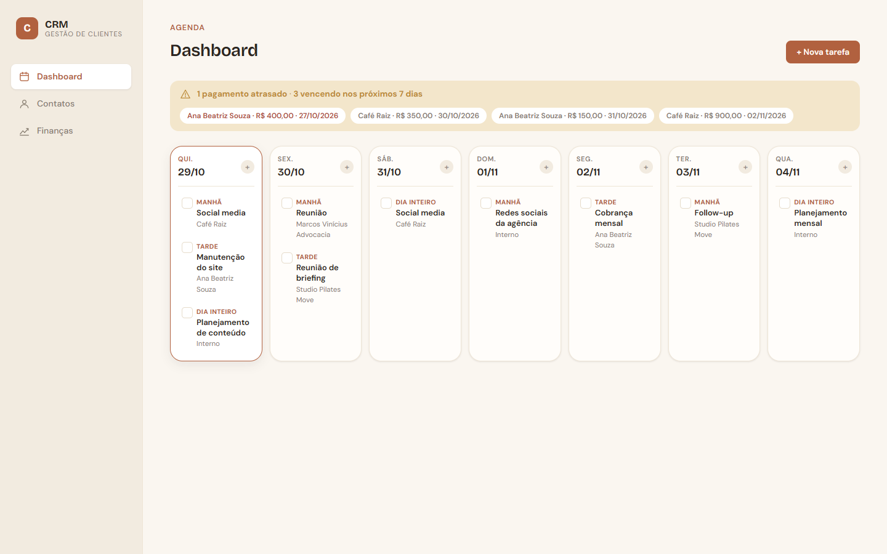
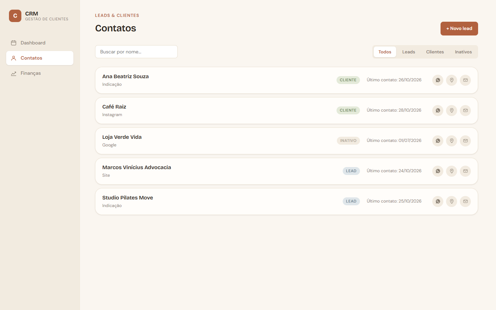
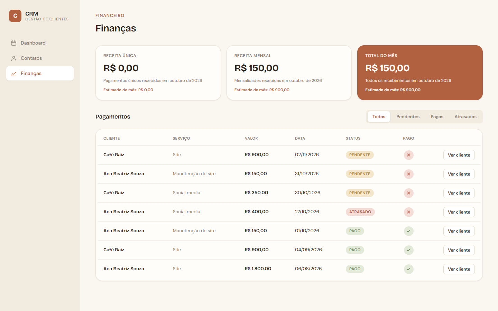
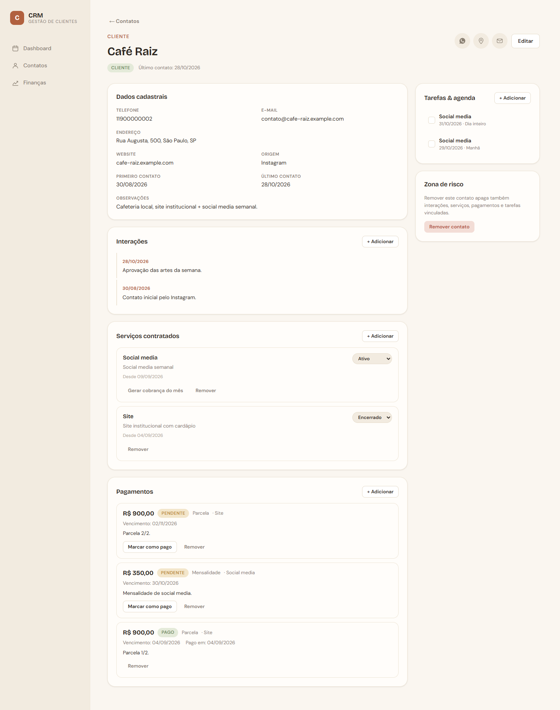

# CRM — Gestão de leads e clientes

**Português** · [English](README.en.md)


Aplicação full-stack para pequenas agências de serviços digitais (sites, marketing e social media) acompanharem o ciclo completo de um cliente: do primeiro contato como **lead** até as **cobranças recorrentes**, passando pelo histórico de conversas e pela agenda da semana.



## Telas

| Contatos | Finanças |
| -------- | -------- |
|  |  |

<details>
<summary>Perfil do contato (dados, interações, serviços, pagamentos e tarefas)</summary>



</details>

> As telas usam os dados fictícios do `seed`.

## Funcionalidades

- **Dashboard semanal**: agenda dos próximos 7 dias e alertas de pagamentos atrasados ou prestes a vencer.
- **Contatos**: busca por nome, filtro por status e atalhos para WhatsApp, Google Maps e e-mail.
- **Funil lead → cliente**: promove um lead cadastrando o serviço contratado e o primeiro pagamento numa única transação.
- **Histórico de interações**: cada registro atualiza automaticamente a data do último contato.
- **Serviços e pagamentos**: cobranças únicas, parceladas ou mensais, upload de comprovante e status "atrasado" calculado a partir do vencimento.
- **Tarefas recorrentes**: repetição diária, semanal, quinzenal, mensal ou personalizada, com opção de editar ou remover só uma ocorrência, as seguintes ou a série inteira.
- **Finanças**: receita recebida no mês comparada com o valor previsto, separada por tipo de cobrança.

## Stack

| Camada   | Tecnologias                                         |
| -------- | --------------------------------------------------- |
| Frontend | Vue 3 (Composition API, `<script setup>`), Vue Router, Vite |
| Backend  | Node.js, Express 5, Multer (upload de arquivos)     |
| Banco    | SQLite via módulo nativo `node:sqlite`              |
| Infra    | Docker (build multi-stage) e Docker Compose         |

## Estrutura

```
.
├── client/                 # SPA em Vue
│   └── src/
│       ├── api/            # cliente HTTP e funções por recurso
│       ├── components/     # componentes reutilizáveis e painéis do contato
│       ├── composables/    # useRequest (loading/erro de chamadas à API)
│       ├── constants/      # rótulos exibidos na interface
│       ├── utils/          # formatação de datas/moeda e links externos
│       └── views/          # páginas
├── server/                 # API REST em Express
│   ├── routes/             # contatos, interações, serviços, pagamentos, tarefas
│   ├── config.js           # variáveis de ambiente
│   ├── db.js               # conexão e helpers (insert, update, transaction)
│   ├── schema.sql          # tabelas e índices
│   └── seed.js             # dados de exemplo
├── Dockerfile
└── compose.yaml
```

## Como rodar

### Com Docker (recomendado)

```bash
docker compose up --build
```

Acesse http://localhost:3000. O banco e os comprovantes ficam no volume `crm-data`.

Para popular com dados de exemplo:

```bash
docker compose exec crm node seed.js
```

### Localmente

Requer **Node.js 22.13 ou superior** (por causa do `node:sqlite`).

```bash
npm install
npm run install:all
npm run seed     # opcional: dados de exemplo
npm run dev      # API em :3000 e frontend em :5173
```

Acesse http://localhost:5173. O Vite redireciona `/api` e `/uploads` para a API.

Para rodar a versão de produção sem Docker:

```bash
npm run build
npm start        # API + frontend em http://localhost:3000
```

> O seed **apaga todos os dados** antes de inserir os exemplos.

### Variáveis de ambiente

| Variável       | Padrão                  | Descrição                                   |
| -------------- | ----------------------- | ------------------------------------------- |
| `PORT`         | `3000`                  | Porta da API                                |
| `DATA_DIR`     | `server/data`           | Pasta do arquivo `crm.db`                   |
| `UPLOADS_DIR`  | `server/uploads`        | Pasta dos comprovantes enviados             |
| `VITE_API_URL` | `http://localhost:3000` | Destino do proxy do Vite em desenvolvimento |

## API

| Método | Rota                                   | Descrição                                       |
| ------ | -------------------------------------- | ----------------------------------------------- |
| GET    | `/api/contacts?status=&q=`             | Lista contatos com filtro e busca               |
| POST   | `/api/contacts`                        | Cria contato                                    |
| GET    | `/api/contacts/:id`                    | Detalha contato                                 |
| PUT    | `/api/contacts/:id`                    | Atualiza contato                                |
| DELETE | `/api/contacts/:id`                    | Remove contato e dados vinculados               |
| POST   | `/api/contacts/:id/promote`            | Converte lead em cliente (serviço + pagamento)  |
| GET    | `/api/contacts/:id/interactions`       | Histórico de interações                         |
| POST   | `/api/contacts/:id/interactions`       | Registra interação                              |
| PUT    | `/api/interactions/:id`                | Edita interação                                 |
| DELETE | `/api/interactions/:id`                | Remove interação                                |
| GET    | `/api/contacts/:id/services`           | Serviços do contato                             |
| POST   | `/api/contacts/:id/services`           | Cadastra serviço                                |
| PUT    | `/api/services/:id`                    | Atualiza serviço                                |
| DELETE | `/api/services/:id`                    | Remove serviço                                  |
| POST   | `/api/services/:id/generate-charge`    | Gera a mensalidade do serviço                   |
| GET    | `/api/payments`                        | Todos os pagamentos                             |
| GET    | `/api/payments/upcoming?days=7`        | Atrasados e a vencer                            |
| GET    | `/api/contacts/:id/payments`           | Pagamentos do contato                           |
| POST   | `/api/contacts/:id/payments`           | Registra pagamento                              |
| PUT    | `/api/payments/:id`                    | Atualiza pagamento                              |
| POST   | `/api/payments/:id/mark-paid`          | Marca como pago (com comprovante opcional)      |
| POST   | `/api/payments/:id/proof`              | Envia comprovante                               |
| DELETE | `/api/payments/:id`                    | Remove pagamento                                |
| GET    | `/api/tasks?from=&to=&contact_id=`     | Lista tarefas por período                       |
| GET    | `/api/tasks/:id`                       | Detalha tarefa                                  |
| GET    | `/api/contacts/:id/tasks`              | Tarefas do contato                              |
| POST   | `/api/tasks`                           | Cria tarefa (ou série recorrente)               |
| PUT    | `/api/tasks/:id`                       | Atualiza tarefa (`scope`: `this`, `following` ou `all`) |
| DELETE | `/api/tasks/:id?scope=`                | Remove tarefa ou parte da série                 |

## Decisões técnicas

- **SQLite nativo do Node (`node:sqlite`)**: nenhuma dependência nativa para compilar e o banco inteiro é um único arquivo, o que facilita backup e deploy.
- **Status de pagamento derivado das datas**: "pago", "pendente" e "atrasado" são calculados a partir de `paid_date` e `due_date`, e os atrasos são atualizados na leitura, sem precisar de cron.
- **Recorrência materializada**: uma série gera 12 ocorrências dentro de uma transação, ligadas por `recurrence_group_id`. Assim cada ocorrência pode ser concluída ou editada sem afetar as outras. Recorrências mensais respeitam o fim do mês (31/01 → 28/02 → 31/03).
- **Datas no fuso local**: datas são formatadas como `YYYY-MM-DD` no horário local, evitando o deslocamento de dia que o `toISOString()` causa à noite no Brasil.
- **Um único container**: em produção o Express serve a API e o build do Vue, então o deploy é só uma imagem e um volume.

## Próximos passos

- Autenticação e suporte a mais de um usuário
- Testes automatizados da API e dos componentes
- Layout responsivo para celular
- Exportação de relatórios financeiros

## Autor

**Lucas Baccelli**: [LinkedIn](https://www.linkedin.com/in/lucasbaccelli) · [GitHub](https://github.com/baxelin)

## Licença

Distribuído sob a licença [MIT](LICENSE).
